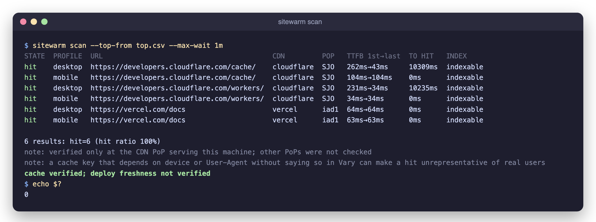

<h1 align="center">
   sitewarm
</h1>

<p align="center">
  <a href="https://github.com/clarivo-co/sitewarm/actions/workflows/ci.yml"></a>
  <a href="https://github.com/clarivo-co/sitewarm/stargazers"></a>
  
  <a href="LICENSE"></a>
  
  <a href="https://github.com/sponsors/ernestova"></a>
  <a href="https://app.fossa.io/projects/git%2Bgithub.com%2Fernestova%2Fsitemap_warmup?ref=badge_shield"></a>
</p>

<p align="center">
  <strong>Warm your top pages after a deploy, and prove the CDN serves them from cache.</strong><br/>
  Per URL and browser profile, on Cloudflare, Vercel, CloudFront, Fastly and Akamai.
</p>

<p align="center">
  
</p>

> **Work in progress.** sitewarm is a Go rewrite. The original Python
> sitemap crawler lives in [`legacy/`](legacy/) and is frozen at tag
> [`v0-python`](https://github.com/clarivo-co/sitewarm/tree/v0-python).

## Build

```
go build -o sitewarm ./cmd/sitewarm
```

## Usage

```
sitewarm scan --top-from top.csv
```

`top.csv` has a header row with a `url` column (absolute URLs) or a `path`
column (resolved with `--base-url`). Rows are in priority order; `--top N`
keeps the first N (default 50).

Or read the URLs from a sitemap:

```
sitewarm scan --from-sitemap https://example.com/sitemap.xml
```

Sitemap indexes are followed, nested ones included, and gzip-compressed
sitemaps (`.gz`) are read. URLs keep their sitemap order and `--top N` keeps
the first N. Pass exactly one of `--top-from` or `--from-sitemap`.

With `--from-sitemap`, sitemap URLs are checked against the site's
`robots.txt` first: the `sitewarm` group applies, or `*` when there is no
`sitewarm` group. A disallowed URL is not requested and is reported as
`skipped-robots`. A `robots.txt` that returns 404 allows everything; any other
error status, or a timeout, skips every URL of that host, with a warning.
`skipped-robots` does not fail the run unless it is in `--fail-on`, but a run
where no URL was verified always fails. `--ignore-robots` turns the check off.
A `--top-from` list is your own choice of pages, so `robots.txt` is not read
for it.

Each URL is requested with two profiles, `desktop` and `mobile`, that send the
navigation headers of current Chrome stable (Windows and Android) plus a
`sitewarm/<version>` token in the User-Agent. sitewarm never impersonates a
crawler. Requests are spread with `--concurrency 4` and a global `--rps 5`
that also covers retries. A `miss` or `stale` URL is requested again every
`--retry-interval 10s` until it is a `hit` or `--max-wait 5m` passes. The whole
run, including reading a sitemap and `robots.txt`, stops at
`--run-timeout 15m`.

| Flag | Default | |
|---|---|---|
| `--top-from` | | CSV with the URLs |
| `--from-sitemap` | | sitemap or sitemap index URL |
| `--ignore-robots` | | with `--from-sitemap`, do not check `robots.txt` |
| `--base-url` | | base for a `path` column |
| `--top` | 50 | URLs to warm |
| `--concurrency` | 4 | requests in flight |
| `--rps` | 5 | global requests per second |
| `--retry-interval` | 10s | wait between attempts |
| `--max-wait` | 5m | retry window per URL (`0` = one request) |
| `--run-timeout` | 15m | cap for the whole run |
| `--fail-on` | `miss,client-error,error,incomplete,noindex,redirect-error` | states that fail the run |
| `--accept-language` | `en-US,en;q=0.9` | for both profiles |
| `--cookie-hosts` | | hosts that may receive cookies |
| `--format` | `table` | stdout format: `table`, `json` or `csv` |
| `--report` | | also write the JSON report to a file |

`--format csv` writes the columns `url,status,state`, one row per URL and
profile, so each URL appears once per profile. `status` is the HTTP status
code, empty when there was no response.

### States

| State | Meaning |
|---|---|
| `hit` | served from the edge cache |
| `stale` | served from cache but expired |
| `miss` | not in cache |
| `bypass` | the CDN does not cache it (BYPASS, DYNAMIC, or a miss with `private`/`no-store`) |
| `variant-unverifiable` | the response has `Vary: User-Agent` |
| `challenged` | 403 or a bot challenge |
| `client-error` | another 4xx (404, 410...) |
| `error` | 5xx, timeout or network error, after 3 retries |
| `redirect-error` | redirect loop, more than 5 hops, or a hop to another host |
| `incomplete` | not finished before `--run-timeout` or an interrupt |
| `unknown` | the CDN does not expose a cache status |
| `skipped-robots` | a sitemap URL not requested because of `robots.txt` |

Supported CDNs: Cloudflare (`cf-cache-status`), Vercel (`x-vercel-cache`),
CloudFront, Fastly (the last value of `x-cache`, the edge that answered) and
Akamai (debug headers requested with `Pragma`). Unmapped values are `unknown`
and the raw value is kept. When several CDNs are stacked, the outermost one
decides.

Redirects are followed up to 5 hops on the same host (apex and `www` count as
one) and the final URL is verified. Bodies are decoded (gzip, deflate, br,
zstd) and the first 256 KB of HTML are checked for `noindex`; the rest is
downloaded and discarded so the CDN finishes caching it. Each request has a
30 s deadline.

### Cookies

Cookies come only from `SITEWARM_COOKIE_DESKTOP` / `SITEWARM_COOKIE_MOBILE`,
are sent only to `--cookie-hosts` and only over HTTPS. A cookie without
`--cookie-hosts` is an error at startup.

### Exit codes

`0` passed, `1` some result is in `--fail-on`, `2` invalid usage or
configuration, `130`/`143` interrupted by SIGINT/SIGTERM. An interrupt or the
run timeout still writes the report, with unfinished URLs as `incomplete`;
a second Ctrl-C exits at once.

### Coming from the Python version

What stays: sitemap indexes, including nested ones and `.gz` sitemaps, are
still followed (now with `--from-sitemap`), and results can still be exported
to CSV (now with `--format csv`, to stdout).

What changes on purpose:

- **User-Agent.** Requests use real Chrome navigation headers plus a
  `sitewarm/<version>` token. The Python version sent a Googlebot
  User-Agent; sitewarm never impersonates a crawler.
- **Input.** A CSV of your top pages (`--top-from`) is the main input; the
  sitemap is optional. With a sitemap, `robots.txt` is respected by default.
- **Flags.** `-s/--site`, `-d/--depth`, `-c/--concurrency`, `-o/--output` and
  `-q/--quiet` are gone. Use `sitewarm scan` with `--from-sitemap`,
  `--concurrency`, `--format csv` and `--fail-on`.
- **CSV columns.** `url,status,state` instead of
  `domain,http_code,time,robots_status,cache_control`. Timings, indexability
  and cache headers are in the JSON report (`--format json` or `--report`).

### Limitations

A `hit` is verified only at the CDN PoP serving the machine that runs
sitewarm. A cache key that depends on device or User-Agent without saying so
in `Vary` can make a `hit` unrepresentative of real users.

## Community & support

- **Bugs and ideas:** [open an issue](https://github.com/clarivo-co/sitewarm/issues/new/choose).
  A wrong cache state has its own form.
- **Contributing:** see [CONTRIBUTING.md](CONTRIBUTING.md).
- **Security:** report privately, see [SECURITY.md](SECURITY.md).
- **Sponsor:** sitewarm is free and open source. If it saves you a cold cache,
  [sponsor its development](https://github.com/sponsors/ernestova) or
  [star the repo](https://github.com/clarivo-co/sitewarm) to follow along.

## License

Apache-2.0. See [LICENSE](LICENSE).
